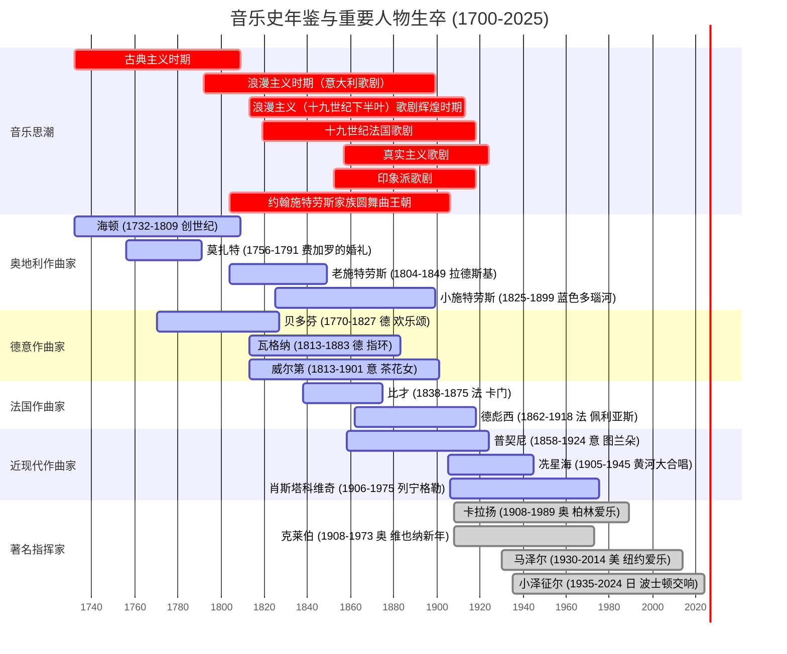

# 中外歌剧赏析 (Appreciation of Chinese and Foreign Opera)

上海科技大学人文通识艺术核心选修课程 **《中外歌剧赏析》** 完整复习备考资料。

> **在线 Notion 复习主页**：[歌剧赏析复习资料 (Notion)](https://equable-field-0c4.notion.site/16a8c4f03b8b803cacebf2cff0c2f087)  
> **本地音视频库**：全套 24 个期末听辨真题音视频片段已完整收录于 [`考试音视频片段/`](./考试音视频片段/) 目录，支持直接点击播放复习。

---

## 🎧 第一部分：期末考试听辨题与标准解析 (24 题全)

| 序号 | 经典选段 / 音视频片段 | 作品 & 考点标准解答 |
| :---: | :--- | :--- |
| 1 | 🎬 [`01_威尔第_茶花女_序曲悲剧主题.mp4`](./考试音视频片段/01_威尔第_茶花女_序曲悲剧主题.mp4) | 意大利作曲家威尔第的歌剧《茶花女》序曲中的“悲剧主题”，描写了女主人公薇奥列塔的悲惨命运。 |
| 2 | 🎬 [`02_威尔第_茶花女_序曲爱情主题.mp4`](./考试音视频片段/02_威尔第_茶花女_序曲爱情主题.mp4) | 意大利作曲家威尔第歌剧《茶花女》序曲中的“爱情主题”，表现了薇奥列塔追求美好爱情的渴望。赏析版本是：1994年英国皇家歌剧院版，指挥：索尔蒂。 |
| 3 | 🎬 [`03_威尔第_茶花女_第一幕饮酒歌.mp4`](./考试音视频片段/03_威尔第_茶花女_第一幕饮酒歌.mp4) | 意大利作曲家威尔第的歌剧《茶花女》，一幕的男女声二重唱“饮酒歌”。薇奥列塔大病初愈，在家里宴请宾客，与阿尔弗莱德初次相见，唱出象征爱情的“饮酒歌”。此版本女高音是乔治乌，男高音是瓦尔加斯。 |
| 4 | 🎬 [`04_威尔第_阿依达_凯旋进行曲.mp4`](./考试音视频片段/04_威尔第_阿依达_凯旋进行曲.mp4) | 意大利作曲家威尔第的四幕歌剧《阿依达》其中的音乐选段“凯旋进行曲”。 |
| 5 | 🎬 [`05_比才_卡门_序曲斗牛士主题.mp4`](./考试音视频片段/05_比才_卡门_序曲斗牛士主题.mp4) | 法国作曲家比才的歌剧《卡门》序曲中的“斗牛士主题”。在全剧中多次出现，表现了斗牛士不怕牺牲的英雄精神。 |
| 6 | 🎬 [`06_比才_卡门_序曲悲剧主题.mp4`](./考试音视频片段/06_比才_卡门_序曲悲剧主题.mp4) | 法国作曲家比才的歌剧《卡门》序曲中的“悲剧主题”，描写了吉普赛姑娘卡门的爱情悲剧。赏析版本是：1988年美国大都会版，指挥：詹姆斯·列文。 |
| 7 | 🎬 [`07_比才_卡门_第四幕幕间曲.mp4`](./考试音视频片段/07_比才_卡门_第四幕幕间曲.mp4) | 法国作曲家比才的歌剧《卡门》“四幕幕间曲”。乐曲用西班牙典型的阿拉贡舞曲的节奏为主体，节奏鲜明、舞蹈性强，双簧管的旋律好像姑娘在歌唱。赏析版本是：1988年美国大都会版，指挥：詹姆斯·列文。 |
| 8 | 🎬 [`08_比才_卡门_第一幕哈巴涅拉_爱情像一只自由的鸟.mp4`](./考试音视频片段/08_比才_卡门_第一幕哈巴涅拉_爱情像一只自由的鸟.mp4) | 法国作曲家比才的歌剧《卡门》一幕女主人公卡门的咏叹调“爱情像一只自由的鸟”（或称为哈巴涅拉）。音乐采用了西班牙的哈巴涅拉舞曲的节奏，表现了卡门奔放、豪爽、敢作敢为的性格。 |
| 9 | 🎬 [`09_比才_卡门_第一幕童声合唱_跟着士兵来换岗.mp4`](./考试音视频片段/09_比才_卡门_第一幕童声合唱_跟着士兵来换岗.mp4) | 法国作曲家比才的歌剧《卡门》中，一幕童声合唱“跟着士兵来换岗”。表现出孩子们的童真。 |
| 10 | 🎬 [`10_比才_卡门_第二幕斗牛士之歌.mp4`](./考试音视频片段/10_比才_卡门_第二幕斗牛士之歌.mp4) | 法国作曲家比才的歌剧《卡门》“斗牛士之歌”。第二幕，在乡村小酒馆里，人们欢呼着，请斗牛士艾斯卡密尤来喝酒，他唱起了“斗牛士之歌”，展示了他的雄姿。 |
| 11 | 🎬 [`11_印青_长征_第一幕男声合唱_神圣的自由谁敢来侵犯.mp4`](./考试音视频片段/11_印青_长征_第一幕男声合唱_神圣的自由谁敢来侵犯.mp4) | 歌剧《长征》，一幕男声合唱“神圣的自由谁敢来侵犯”。作曲：印青，编剧：邹静之。2016年7月1日首演于国家大剧院。 |
| 12 | 🎬 [`12_印青_长征_第三幕三月桃花心中开.mp4`](./考试音视频片段/12_印青_长征_第三幕三月桃花心中开.mp4) | 歌剧《长征》第三幕“遵义”，男女兵拉歌、写标语比赛时，引出了这首流传于江西老家的民歌，“三月桃花心中开”唱到“前路漫漫红军来”，表达对胜利的期盼。 |
| 13 | 🎬 [`13_印青_长征_第五幕我的爱人你可听见.mp4`](./考试音视频片段/13_印青_长征_第五幕我的爱人你可听见.mp4) | 歌剧《长征》五幕二场过草地时，彭政委思念离别的妻子，唱起了“我的爱人 你可听见”。深情地表达了“革命的理想永不改变”的坚定信念。 |
| 14 | 🎬 [`14_罗西尼_塞维利亚理发师_快给大忙人让路.mp4`](./考试音视频片段/14_罗西尼_塞维利亚理发师_快给大忙人让路.mp4) | 意大利作曲家罗西尼的歌剧《塞维利亚理发师》一幕费加罗的咏叹调“快给大忙人让路”。表明他是一个热心肠的理发师，愿意帮助他人解决困难。 |
| 15 | 🎬 [`15_罗西尼_塞维利亚理发师_造谣诽谤.mp4`](./考试音视频片段/15_罗西尼_塞维利亚理发师_造谣诽谤.mp4) | 意大利作曲家罗西尼歌剧《塞维利亚理发师》二幕音乐教师巴西利奥的咏叹调“造谣、诽谤”。表明他是一个喜欢混淆视听，生怕天下不乱的小人。 |
| 16 | 🎬 [`16_莫扎特_费加罗的婚礼_现在你再不要去做情郎.mp4`](./考试音视频片段/16_莫扎特_费加罗的婚礼_现在你再不要去做情郎.mp4) | 奥地利作曲家莫扎特的歌剧《费加罗的婚礼》一幕尾费加罗的咏叹调“现在你再不要去做情郎”。费加罗帮助主人，开导情窦初开的侍童凯鲁比诺，送他去当兵。 |
| 17 | 🎬 [`17_莫扎特_费加罗的婚礼_第三幕二重唱微风轻轻吹起的地方.mp4`](./考试音视频片段/17_莫扎特_费加罗的婚礼_第三幕二重唱微风轻轻吹起的地方.mp4) | 奥地利作曲家莫扎特的歌剧《费加罗的婚礼》三幕女声二重唱“微风轻轻吹起的地方”。女仆苏珊娜与伯爵夫人一起给伯爵写一封约会信，引他上钩。电影《肖申克的救赎》中著名插曲。 |
| 18 | 🎬 [`18_贝多芬_第九交响曲_欢乐颂.mp4`](./考试音视频片段/18_贝多芬_第九交响曲_欢乐颂.mp4) | 《欢乐颂》选自德国作曲家贝多芬的第九交响曲第四乐章。歌词来源于德国诗人席勒的诗。德文原文演唱，由卡拉扬指挥。“欢乐女神，圣洁美丽，灿烂光芒照大地”。 |
| 19 | 🎬 [`19_普契尼_图兰朵_主人请听我说.mp4`](./考试音视频片段/19_普契尼_图兰朵_主人请听我说.mp4) | 意大利作曲家普契尼的歌剧《图兰朵》，一幕柳儿的咏叹调。“主人，请听我说”是一首带有中国音乐元素的女高音音乐段落。她劝王子不要去冒险猜谜。 |
| 20 | 🎬 [`20_普契尼_图兰朵_今夜无人入睡.mp4`](./考试音视频片段/20_普契尼_图兰朵_今夜无人入睡.mp4) | 意大利作曲家普契尼的歌剧《图兰朵》，三幕匿名王子的咏叹调“今夜无人入睡”。王子猜中了图兰朵公主的三个谜语。为了保全公主的名声，他让公主猜他的名字，表达了对胜利的渴望。 |
| 21 | 🎬 [`21_普契尼_蝴蝶夫人_当晴朗的一天.mp4`](./考试音视频片段/21_普契尼_蝴蝶夫人_当晴朗的一天.mp4) | 意大利作曲家普契尼的歌剧《蝴蝶夫人》二幕乔乔桑的咏叹调“当晴朗的一天”。乔乔桑每天都站在高山上眺望港口，期待着三年未见的新婚丈夫平克尔顿能够归来。 |
| 22 | 🎬 [`22_小约翰施特劳斯_蝙蝠_序曲舞会主题.mp4`](./考试音视频片段/22_小约翰施特劳斯_蝙蝠_序曲舞会主题.mp4) | 奥地利作曲家小约翰•施特劳斯的轻歌剧《蝙蝠》序曲，是音乐会上经常上演的经典曲目，是一首多主题的序曲。这是其中的“舞会主题”。 |
| 23 | 🎬 [`23_小约翰施特劳斯_蝙蝠_第二幕笑之歌.mp4`](./考试音视频片段/23_小约翰施特劳斯_蝙蝠_第二幕笑之歌.mp4) | 奥地利作曲家小约翰•施特劳斯的轻歌剧《蝙蝠》第二幕中的“笑之歌”是女仆阿黛丽在俄罗斯亲王举办的化妆舞会上，假扮成女演员，戏弄自己的主人埃森施泰因时唱的。 |
| 24 | 🎬 [`24_小约翰施特劳斯_蓝色多瑙河圆舞曲.mp4`](./考试音视频片段/24_小约翰施特劳斯_蓝色多瑙河圆舞曲.mp4) | 奥地利作曲家小约翰•施特劳斯的作品“蓝色多瑙河”圆舞曲。作品描写了熬过寒冬的人们，面对春天来了的美好赞颂。选自1992年《维也纳新年音乐会》克莱伯指挥。 |

---

## 🎼 第二部分：主要西方音乐史思潮与时期划分

- **古典主义时期 (约 1730 - 1820)**：强调形式的完整性、对称性与优雅，代表人物有海顿、莫扎特和早期贝多芬。
- **浪漫主义时期 (约 1810 - 1910)**：强调情感主观表达、个性解放与民族色彩，代表人物有威尔第、瓦格纳、罗西尼、比才、施特劳斯家族。
- **民族乐派时期 (19 世纪末 - 20 世纪初)**：强调民族精神与民间传统素材，代表人物有冼星海等。
- **现代主义时期 (20 世纪)**：多元化探索，包含表现主义、新古典主义等，代表人物有肖斯塔科维奇、德彪西（印象派）。

---

## 🏛️ 第三部分：核心作曲家与指挥家速查对照表

| 作曲家 / 指挥家 | 国籍 | 生卒年 | 代表作品 / 乐章 | 历史地位与考试常考要点 |
| :--- | :--- | :--- | :--- | :--- |
| **海顿** | 奥地利 | 1732-1809 | 《创世纪》《四季》《伦敦交响曲》 | 交响曲之父，维也纳古典乐派奠基人 |
| **莫扎特** | 奥地利 | 1756-1791 | 《费加罗的婚礼》《魔笛》《唐璜》 | 音乐神童，古典主义大师 |
| **贝多芬** | 德国 | 1770-1827 | 第九交响曲第四乐章《欢乐颂》《命运》 | 乐圣，古典主义向浪漫主义过渡的核心枢纽 |
| **罗西尼** | 意大利 | 1792-1868 | 《塞维利亚理发师》《威廉·退尔》 | 早期意大利浪漫主义喜歌剧巨匠 |
| **老约翰·施特劳斯** | 奥地利 | 1804-1849 | 《拉德茨基进行曲》 | 维也纳圆舞曲之父 |
| **威尔第** | 意大利 | 1813-1901 | 《茶花女》《阿依达》《弄臣》 | 19 世纪意大利浪漫主义歌剧最伟大代表 |
| **瓦格纳** | 德国 | 1813-1883 | 《尼伯龙根的指环》《特里斯坦与伊索尔德》 | 乐剧（Music Drama）倡导者与音乐戏剧改革家 |
| **小约翰·施特劳斯** | 奥地利 | 1825-1899 | 《蓝色多瑙河》《蝙蝠》《维也纳森林的故事》 | 圆舞曲之王，维也纳轻歌剧奠基人 |
| **比才** | 法国 | 1838-1875 | 《卡门》《阿莱城姑娘》 | 19 世纪法国写实主义歌剧大师 |
| **普契尼** | 意大利 | 1858-1924 | 《图兰朵》《蝴蝶夫人》《波西米亚人》《托斯卡》 | 真实主义/浪漫晚期抒情歌剧宗师 |
| **德彪西** | 法国 | 1862-1918 | 《佩利亚斯与梅丽桑德》《牧神午后前奏曲》 | 印象主义音乐创立者与代表人物 |
| **冼星海** | 中国 | 1905-1945 | 《黄河大合唱》 | 人民音乐家，中国近代新音乐先驱 |
| **肖斯塔科维奇** | 苏联 | 1906-1975 | 第七交响曲《列宁格勒交响曲》 | 20 世纪苏俄最重要的交响乐作曲家之一 |
| **卡拉扬** | 奥地利 | 1908-1989 | 柏林爱乐乐团指挥（指挥《欢乐颂》等） | 20 世纪“指挥皇帝” |
| **克莱伯** | 奥地利 | 1908-1973 | 1992 年维也纳新年音乐会（指挥《蓝色多瑙河》） | 传奇指挥大师 |
| **马泽尔** | 美国 | 1930-2014 | 纽约爱乐乐团总监（指挥《塞维利亚理发师》） | 现代顶尖指挥巨擘 |
| **小泽征尔** | 日本 | 1935-2024 | 波士顿交响乐团总监（指挥《波西米亚人》） | 享誉全球的东方指挥大师 |
| **捷杰耶夫** | 俄罗斯 | 1953- | 马林斯基剧院总监（指挥《天鹅湖》等） | 当代俄罗斯指挥学派领袖 |

---

## 📅 第四部分：音乐史年鉴甘特图 (1700 - 2025)

